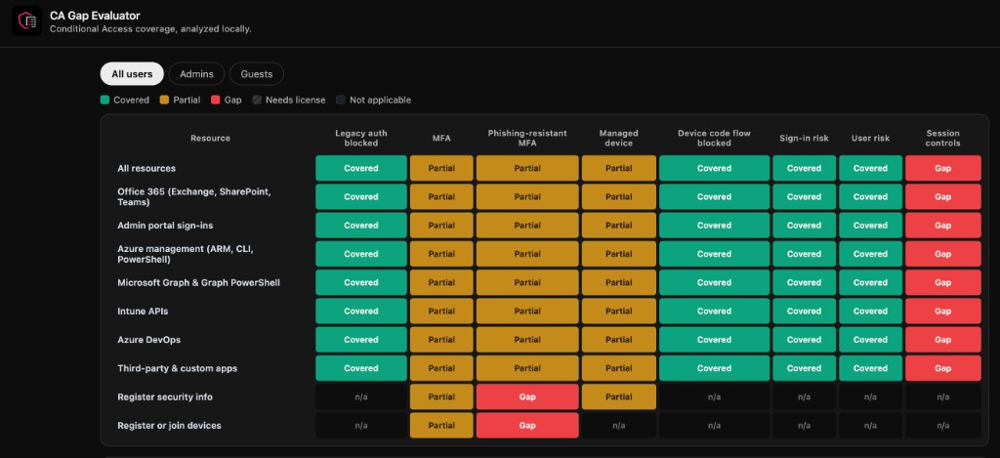

# CA Gap Evaluator



A browser-only tool for finding coverage gaps in Microsoft Entra ID Conditional Access. Import Graph policy JSON or enter policies by hand, then review a heat map, a findings list, and a printable report. Nothing is sent to a server.

## Run locally

```bash
npm install
npm run dev
```

Open the URL Vite prints (usually `http://localhost:5173`).

```bash
npm test
npm run build
```

## Importing policies

From Graph:

```
GET https://graph.microsoft.com/beta/identity/conditionalAccess/policies
```

Paste the JSON (a single policy, an array, or `{ "value": [...] }`) on the Policies step.

## Heat map colors

| Color | Meaning |
|---|---|
| Green | Enforced coverage |
| Amber | Partial (report-only, weakened grant, or narrowed conditions) |
| Red | Gap |
| Hatched gray | Control needs a license you did not select |
| Empty | Not applicable (for example managed device on device registration) |

Rows are resource surfaces (including Microsoft Graph, Intune APIs, and Azure DevOps, which Microsoft Admin Portals does not cover). Columns are controls. Use the All users / Admins / Guests tabs to switch population.

## Limits

The app has no live tenant connection. Group membership, PIM eligible assignments, service principals, and several tenant-wide settings appear on the **Verify manually** checklist.

App catalog date: **2026-10-26**. Research notes: `docs/research/`.
